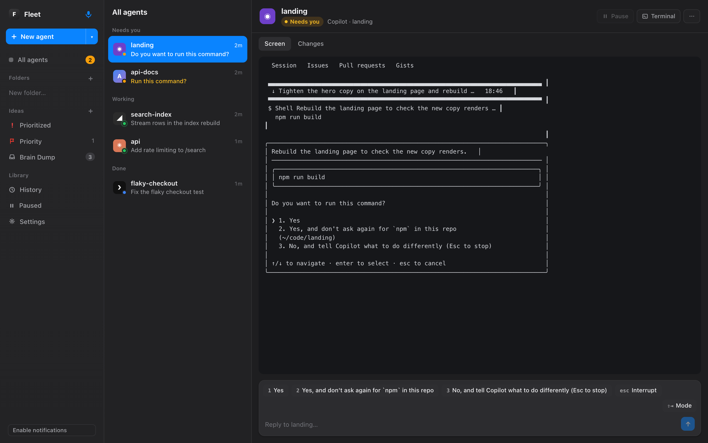
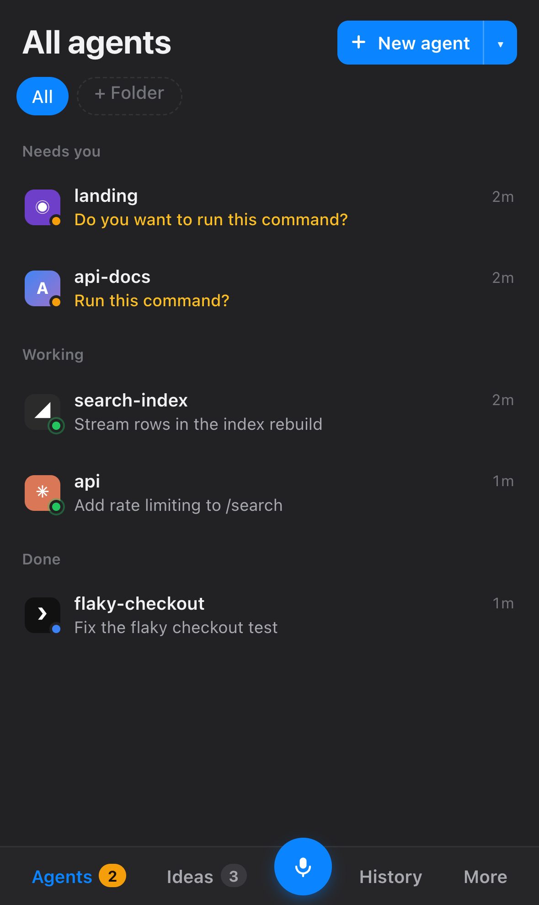
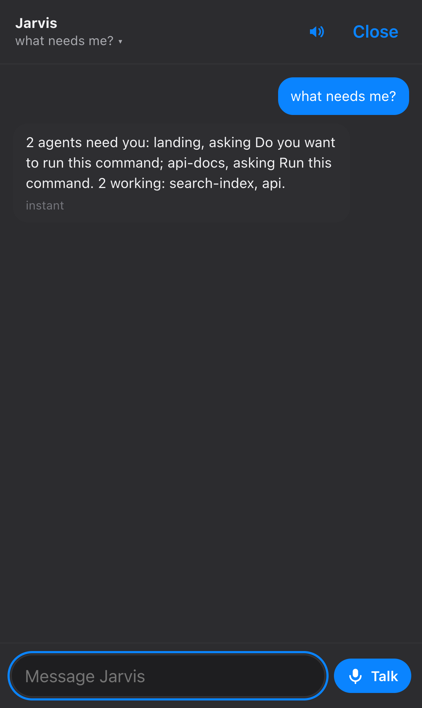

# Agent Fleet

**by [Optimal Data Inc.](https://optimaldata.org)** · MIT licensed

Run Claude Code, Codex, Cursor, Copilot and Antigravity side by side, keep them alive when the
terminal or SSH connection drops, and answer them from your phone. It all runs on your own Mac:
no account, no cloud relay, and the AI features use the subscriptions you already have.

<p align="center"></p>
<p align="center">
  
  &nbsp;
  
</p>

- **Every agent in one list:** needs you, working, done or crashed, across all five tools.
- **Answer from anywhere:** one-tap menu answers, a reply box and a full terminal, on the Mac or
  your iPhone over Tailscale, with a push when an agent needs you.
- **Agents that survive:** close the window or lose the SSH connection and the agent keeps going.
  Pause one until 6:30 and it comes back on its own.
- **Jarvis:** talk or type ("what needs me?", "tell api yes"). It reads freely and asks before it
  touches an agent.
- **Ideas:** a checklist inbox where any idea can become an agent with one tap.

## Install

```
git clone https://github.com/wgrazz/agent-fleet
ln -s "$PWD/agent-fleet/fleet" ~/.local/bin/fleet     # anywhere on PATH
fleet new my-task        # a protected session in this folder: run claude / codex / agent inside it
fleet dash install       # the dashboard, at login (add --local if you don't use Tailscale)
```

The CLI needs Python 3.9+, tmux, and `lsof`/`ps` (present on macOS and Linux). `caffeinate` is
used when present, so Linux works too; it just doesn't block sleep. The dashboard needs macOS
and Node.js 24+.

## The CLI

```
$ fleet
   PID  TOOL    STATUS            AGE  WHERE                         DIR             TASK
 41922  claude  working       2:14:07  safe · api · background       shop-app        [busy] Add rate limiting to /search
 43310  codex   needs you       31:50  dies with window              landing         Trim the hero copy
  + 3 background helpers (fleet all)

WAITERS
   PID  OWNER                  AGE  COMMAND
 42001  claude 41922       1:03:12  /bin/sh -c until ssh server 'test -f /tmp/done'; do sleep 300; done
```

Agents started in a plain terminal die when that window closes or a Termius / SSH connection
drops, along with the hour of work they were in the middle of. `fleet new NAME` starts a
protected tmux session (with `caffeinate` on macOS so the laptop doesn't sleep) and you run the
agent inside it. `fleet` then shows every agent on the box, whether it is protected, what it is
working on, and any follow-up waiters it armed. `fleet kill` cleans up.

## Commands

| Command | What it does |
| --- | --- |
| `fleet new NAME` | Start a protected session called NAME in the current folder, then run `claude` / `codex` / `agent` inside it |
| `fleet new NAME --tool T [--model M] [--effort E] [--profile P] [--detach] [PROMPT]` | Start NAME already running `claude`, `codex`, `cursor`, `copilot` or `agy`, optionally with a first prompt (`--resume ID` continues a past conversation) |
| `fleet pause NAME` | Stop NAME's agent but keep its conversation; `fleet paused` lists, `fleet unpause ID\|NAME` brings it back |
| `fleet idea [-l LIST] TEXT` | Jot an idea into `~/.fleet/fleet.db` (Brain Dump unless you name a list) |
| `fleet import-notes [--dry-run]` | Copy your numbered Apple Notes checklists into Ideas, checked items as done (needs Full Disk Access) |
| `fleet rename OLD NEW` | Rename a session |
| `fleet json` | The agent list as JSON (what the dashboard reads) |
| `fleet dash` | Open the dashboard |
| `fleet hooks install` / `uninstall` | Add or remove the Claude Code hooks that report status to the dashboard |
| `fleet mac …` | Jarvis's Mac abilities: `music`, `calendar`, `event`, `reminders`, `remind`, `draft`, `apps`, `open`, `window`, `screen`, `hotkey install` |
| `fleet tts install` | A natural voice for Jarvis (Kokoro, runs on this Mac, ~350 MB in `~/.fleet/tts`) |
| `fleet resume [NAME]` | Reattach (no name: the only session, or a list) |
| `fleet peek NAME` | Print the last 40 lines of NAME's screen without attaching |
| `fleet` | Agents you started, what they're doing, and any waiters |
| `fleet all` | Same, plus background helpers (desktop apps, Codex service, chrome bridge, claude-mem) |
| `fleet kill PID\|NAME` | Stop one agent or waiter, or a whole session |
| `fleet kill --all` | Stop every agent and waiter you started, after a y/N prompt |
| `fleet selftest` | Offline check of the process-tree logic |

Inside a session: `Ctrl-b d` detaches (the agent keeps running), `Ctrl-b [` scrolls.

The TASK column reads Claude Code's session files (`~/.claude/sessions/<pid>.json` and the
transcript title) and Codex's thread database (`~/.codex/state_*.sqlite`). Cursor shows no task.

## Dashboard

A web page for the same agents, on the Mac and as an iPhone home-screen app over Tailscale.

```
fleet dash install       # runs the server at login (launchd) and publishes it to your tailnet
fleet hooks install      # optional: exact status from Claude Code instead of reading its screen
fleet dash               # open it on this Mac
fleet dash app           # open it in Safari, then File → Add to Dock for a Mac app
fleet dash update        # after changing the dashboard's code: rebuild + restart
```

`fleet dash install` prints two links that end in `?key=…`. Open one once per device and the key
is remembered. Without it the page shows "Fleet is locked". The key, push keys, profiles, paused
sessions, folders and ideas live in `~/.fleet/` (readable only by you). None of it is in this repo.

**Agents**
- Status at a glance: needs you, working, done, crashed.
- A live **Screen**, a readable **Chat** (Claude and Codex, read from their own logs), and
  **Changes**: git files, commits and push state in the agent's repos.
- One-tap answers to menus, a reply box, and a full terminal.
- **Hold** (phone) or **right-click** (Mac) an agent for rename, move to folder, pause, **pause
  until** a time (it comes back on its own), terminal and kill.
- **Outside Fleet:** agents running in plain terminal windows are listed in their own section.
  **Add to Fleet** (or `fleet adopt PID`) stops one and continues the same conversation inside
  Fleet.
- While an agent works, the chat shows what it's doing and a **Live** view of its screen. The
  **Mode** button sends Shift+Tab.
- **Folders**: you make them, then drag agents in or use the menu. A folder follows the
  conversation, so it survives renames and pause/resume. Past conversations can be filed too.

**New agent**
- Quick start with your default profile, saved profiles, or Custom.
- Custom has **Improve prompt**: Claude rewrites a rough prompt the way Anthropic recommends
  (goal, context, how to verify, real constraints) after a quick read-only look at the project
  for real file names. It lists what it changed and any open questions.
- **Suggest model** picks a tool, model and effort for the task, weighing how much of each
  subscription is left, and offers an alternative.
- **Interview me about an idea** starts a Claude agent that asks one question at a time, pushes
  back, then writes a spec to `docs/ideas/` and adds it to Priority.

**Ideas**
- Checklist lists. Priority and Brain Dump are pinned; the rest are yours: rename, recolor,
  reorder, delete.
- Repeating items (daily, weekly on a day, monthly on a date, every N days) uncheck themselves
  on schedule.
- **Sort** walks Brain Dump one item at a time with Claude's guess at the right list. Enter
  accepts, 1-9 picks a list, D deletes, A starts an agent, S skips. On a phone, swipe.
- Any idea can become an agent (it shows the agent's status and offers "mark done" when it
  finishes) or an interview.
- Capture with ⌘I, `fleet idea "…"`, or Jarvis.
- `fleet import-notes` (or Ideas ⋯ → Import from Apple Notes) copies your numbered checklist
  notes, with checked items in Done. macOS only allows this from an app with Full Disk Access.

**History.** Every past Claude and Codex conversation: search, read as chat, resume, file into
folders.

**Usage.** 5-hour and weekly limits:
- Claude: from Claude Code's status line. Its `statusline.sh` writes `~/.fleet/claude-usage.json`.
- Codex: from its session logs.
- Copilot: from the plan counter it prints.
- Cursor and Antigravity don't expose theirs.

**Jarvis.** The mic in the sidebar, the middle of the phone tab bar, or `J`. Type or talk.
- **Instant, no AI:** "what needs me?", "tell api yes", "pause api until 18:30",
  "idea: …", "remember …".
- **Everything else goes to Claude as your project agent.** It only reads (the project and the web)
  and keeps lasting notes in `~/.fleet/jarvis-memory.md`.
- **It asks before touching agents.** Starting an agent or typing into one shows an **Approve / No**
  card, and saying "yes" or "do it" approves it. Things you command directly ("tell api yes")
  happen right away.
- **Conversations.** Each has its own title and memory, and a new one starts after 2 hours of quiet.
  Tap the title to switch or start fresh. They're shared between your phone and Mac.
- **Talk** starts a voice conversation: it listens, answers out loud, and listens again until you
  end it. Tap the orb to interrupt; saying "that's all" ends it. The speaker button mutes replies.
- **Weekly cost cap.** Jarvis's share of your weekly Claude limit is shown in the panel, with a
  warning at 5% and a stop at 10% (`jarvis_warn_pct` / `jarvis_max_pct` in `~/.fleet/config.json`).
  The share is computed from what every Claude session cost this week.
- **Natural voice:** `fleet tts install` adds Kokoro, an open-weight voice model that runs on your
  Mac. Audio is made there and played on whichever device you're using. Pick a voice (British
  George, Fable, Daniel, Lewis, and more) under Settings → Jarvis's voice. Mac voices and the
  device's own voice are there too.
- It answers out loud and can speak alerts when agents need you (a setting, off by default).
- Voice input uses the browser's speech recognition, and you can always type instead.

**Jarvis on your Mac.** One assistant for agents and your day, from your phone or the Mac.
- **Music (Spotify):** "pause", "next song", "what's playing", "volume 30", "play some lo-fi".
- **Calendar and Reminders:** "what's on tomorrow?", "remind me Friday at 9 to check the deploy".
  These go through EventKit, so recurring events and every account on the Mac are included.
- **Email:** "draft a reply to Sam saying I'll send it Monday" saves a draft in Mail. Nothing is
  ever sent.
- **Apps and windows:** "open Figma", "put Safari on the left".
- **Your screen:** "what's on my screen?" (Jarvis takes a screenshot and reads it).
- **⌃⌥Space** anywhere on the Mac opens Jarvis ready to talk (`fleet mac hotkey install`).

Reading things and music happen right away. Calendar events, reminders and email drafts show an
**Approve** card first. Each ability asks macOS for permission once: Settings → **Mac access** →
**Set up all**, while you're at the Mac.

**Jarvis outside the dashboard.** `fleet ask "what needs me?"` talks to the same Jarvis, with the
same memory, cost cap and actions, from any terminal or script. That makes it easy to connect to:

- **Siri, hands-free on the iPhone.** On the phone, open Settings → **Hey Siri** → **Add the Jarvis
  shortcut** (or run `fleet dash siri` on the Mac and AirDrop the file). Say "Hey Siri, Jarvis", then
  talk; Siri reads the answer and listens again until you stop talking. To build it by hand instead,
  make a shortcut named "Jarvis":
  1. **Dictate Text.**
  2. **Get Contents of URL:**
     - URL: `https://<your-mac>.<tailnet>.ts.net/api/jarvis`
     - Method: POST
     - Header: `X-Fleet-Key: <your key>`
     - JSON body: `text` = Dictated Text
  3. **Get Dictionary Value** `say`.
  4. **Speak Text.**

  Then say "Hey Siri, Jarvis". Tailscale must be on.

**Keys:**

| Key | Action |
| --- | --- |
| ⌘K | Jump anywhere |
| ⌘I | New idea |
| N | New agent |
| J | Jarvis |
| ↑ / ↓ | Move through agents |
| 1-9 | Answer menus |
| / | Reply box |

The smart features (Improve, Suggest, Sort, Interview, Jarvis) run on your own Claude
subscription through the Claude Code CLI (`claude -p`, Sonnet by default; set `FLEET_AI_MODEL`
to change it). They don't use an API key.

**iPhone:**
1. Open the tailnet link in Safari, then Share → Add to Home Screen.
2. Open Fleet from the new icon and tap **Enable notifications**.

You get a push when an agent needs you, finishes or crashes, and tapping it opens that agent.
iOS only allows web push over HTTPS, so enable HTTPS certificates in the Tailscale admin console
(DNS page) before running `fleet dash install`. Without Tailscale, use
`fleet dash install --local` for a Mac-only dashboard.

**How status works:** Claude Code reports exactly through its hooks. Codex, Cursor, Copilot and
Antigravity are read from their screens every 2 seconds, using patterns taken from real captures
(`dashboard/test/fixtures/`). When a guess is wrong, save the screen
(`tmux capture-pane -p -t =NAME: > dashboard/test/fixtures/<tool>/<state>-<label>.txt`) and fix
the pattern in `dashboard/server/detect.ts`. Agents started in a plain terminal window show up
(Claude and Codex ones with their chat), but only agents in tmux (`fleet new` or the dashboard)
can be answered from it.

Needs Node.js 24+. In `dashboard/`:
- `npm test` runs the detector, Ideas and end-to-end tests.
- `npm run typecheck` checks types.
- `npm run dev` serves the page with hot reload against a running server.

## agent-notify.sh

A nine-line companion: agents call it when a long job finishes, blocks, or gives up, so you get
a Discord ping instead of checking back.

```
export DISCORD_AGENT_WEBHOOK=https://discord.com/api/webhooks/...
AGENT_NAME=claude ./agent-notify.sh "Nightly import finished: 347 rows loaded"
# → [claude @ shop-app] Nightly import finished: 347 rows loaded
```

It never fails the caller: a missing webhook or a failed post only warns on stderr.

## The long-wait pattern this supports

Tell your agents (in `AGENTS.md`) that when they start something that takes more than a few
minutes they should arm a follow-up — a background `until <check>; do sleep 300; done` loop
that re-wakes the session — say so in one line, and notify on result. `fleet` shows those
waiters under their owning agent, and `fleet new` is what lets them survive a dropped
connection. See [polyagent-kit](https://github.com/wgrazz/polyagent-kit) for the rule text.

## License

MIT
